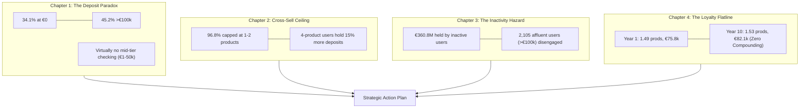

# 📈 Retail Banking Customer Intelligence: Strategic Narrative & Execution Plan
*Source Dataset: `cleaned_data.csv` | Total Validated Records: 10,000 | Deposits Under Management: €774.14 Million*

---

## 🧭 Executive Summary: The Macro Narrative

Our analysis of the post-hygiene dataset ([cleaned_data.csv](file:///home/abantika/Documents/abantika_projects/data_hygine/cleaned_data.csv)) reveals a retail bank with strong aggregate capital reserves (**€773.7M in deposits**) and steady customer tenure (**5.0 years on average**). 

However, beneath these top-line numbers lies a **fragile commercial model**:
1. **Capital is polarized:** Over a third of accounts (**34.1%**) sit completely unfunded (€0.00), while virtually all funded accounts hold significant deposits (>€50k–€100k).
2. **Relationships are shallow:** **96.8% of customers** are capped at holding only 1 or 2 products.
3. **Retention is passive, not proactive:** Customer value does not compound over time—a 10-year customer holds the same product count and deposit balance as a 1-year newcomer.
4. **Massive capital is disengaged:** Over **€360.8M in deposits** sits with customers who are technically inactive and at high risk of silent churn.

This document sets out the full business story followed by an executive-ready execution roadmap.

---

## 📊 1. Portfolio Baseline Metrics

| Metric | Portfolio Total / Mean | Benchmark / Interpretation |
| :--- | :--- | :--- |
| **Clean Customer Base** | **10,000** accounts | Validated and deduplicated (from 10,100 raw) |
| **Total Balance (AUM)** | **€773,715,355.92 (~€773.7M)** | Total liquidity held across all 3 countries |
| **Overall Mean Balance** | **€77,417.99** | Reflects drag of 3,411 €0 accounts |
| **Funded Account Mean Balance** | **€117,532.48** | True average among active depositors |
| **Zero-Balance Accounts** | **3,411 (34.13%)** | High operational cost with zero deposit margin |
| **Credit Card Penetration** | **70.75% (7,071)** | High card adoption; credit-first relationship |
| **Active Membership Rate** | **52.86% (5,283 active)** | **47.14% (4,711)** disengaged accounts |
| **Average Credit Score** | **648.96** | Centered in the Fair/Good credit range |
| **Average Age / Tenure** | **38.84 yrs / 5.00 yrs** | Prime working age; steady multi-year tenure |

---

## 📖 2. The Strategic Narrative: Five Core Stories



### Chapter 1: The Bimodal Deposit Paradox (The All-or-Nothing Balance)
* **The Finding:** 3,411 accounts (34.1%) hold €0.00. 4,521 accounts (45.2%) hold more than €100,000. Only 78 customers (0.8%) hold between €1 and €50,000.
* **The Story:** The bank does not have a typical bell-curve retail deposit distribution. Customers do not use the bank as their primary checking or payroll account. Instead, customers use the bank either as an **exclusive credit card utility** with no savings attached, or as a **high-balance savings vault**.
* **The Commercial Risk:** Maintaining 3,411 €0 accounts carries regulatory overhead, fraud monitoring costs, and infrastructure drag with negative unit economics.

### Chapter 2: The Two-Product Ceiling (Stalled Cross-Selling)
* **The Finding:** 52.1% hold 1 product; 44.8% hold 2 products; only 3.1% hold 3 or 4 products.
* **The Story:** Customers open an account and accept a credit card—and the relationship stops there. The bank has failed to cross-sell mortgages, insurance, wealth management, or auto loans.
* **The Commercial Upside:** Customers holding 4 products maintain the highest average balance (**€88,664** vs €77,172) and highest engagement (**57.4%** active). Moving just 5% of 2-product holders to 3+ products unlocks substantial fee and interest income.

### Chapter 3: The €361 Million Inactivity Hazard (Silent Churn Vulnerability)
* **The Finding:** 47.14% of the customer base (4,711 customers) are inactive (`active_member = 0`). Together, they hold **€360,838,478**.
* **The Story:** High-net-worth customers (>€100k) represent 2,105 inactive accounts. In banking, affluent customers rarely announce account closures; they silently transition their wealth to neobanks, brokerages, or higher APY institutions.
* **The Commercial Risk:** Losing even 10% of these disengaged affluent accounts represents a sudden **€25M–€35M liquidity drain**.

### Chapter 4: The Flatlining Loyalty Curve (Tenure Without Compounding)
* **The Finding:** Tenure is distributed evenly across 10 years, but customer metrics remain completely flat:
  * **Tenure Year 1:** 1.49 products | €75,760 avg balance | 50.7% active
  * **Tenure Year 5:** 1.56 products | €76,303 avg balance | 55.0% active
  * **Tenure Year 10:** 1.53 products | €82,071 avg balance | 50.8% active
* **The Story:** A customer who has banked here for a decade receives the same treatment, the same products, and keeps the same deposit volume as a customer who joined last week. The bank is currently a **transaction utility**, not a relationship bank.

### Chapter 5: Geographic Realities (Volume vs. Wealth vs. Dormancy)
* **France (50.96% base | €393.8M AUM):** The retail scale anchor. Largest volume of accounts and revenue.
* **Germany (24.39% base | €193.8M AUM):** The wealth-density market. Holds the highest average balance per customer (**€79,484.04** overall; €118,016 among funded accounts). Highest ROI potential for wealth management and premium services.
* **Spain (24.64% base | €186.1M AUM):** The highest dormancy rate (**35.61% zero-balance accounts**). Requires aggressive deposit mobilization and direct-deposit payroll incentives.

---

## 👥 3. Customer Personas & Value Matrix

```
       HIGH VALUE
           ▲
           │   [ Persona 3: Silent VIPs ]           [ Persona 2: Family Builders ]
           │   • 21.1% of base                      • 35.0% of base
           │   • Balance: >€100k                    • Balance: €50k-€150k
           │   • Active: NO                         • Active: YES
           │   • Strategy: White-Glove Retention    • Strategy: Multi-Product Lending
DEPOSITS   │
           │────────────────────────────────────────────────────────────────────────
           │   [ Persona 1: Dormant Transactors ]   [ Persona 4: Credit-Constrained ]
           │   • 34.1% of base                      • 59.3% of base
           │   • Balance: €0                        • Balance: >€75k
           │   • Active: Mixed / Cardholders        • Credit Score: <670
           │   • Strategy: Payroll Activation       • Strategy: Collateralized Loans
           ▼
       LOW VALUE ────────────────────────────────────────────────────────► HIGH ENGAGEMENT
```

### Detailed Persona Profiles:

#### 1. The Dormant Transactor (34.1% | 3,411 accounts)
* **Profile:** €0 balance, but 70.5% hold a credit card.
* **Risk:** High servicing cost, zero interest margin, card default risk.
* **Objective:** Turn them into primary depository customers.
* **Tactic:** Offer €50 statement credit or fee-free foreign transactions upon linking recurring payroll direct deposits.

#### 2. The Core Family Builder (35.0% | ~3,500 accounts)
* **Profile:** Aged 30–45, €50k–€150k balance, active member, 1–2 products.
* **Opportunity:** High demand for life-stage financing (home purchases, child education, auto upgrades).
* **Objective:** Expand product penetration from 2 to 3+.
* **Tactic:** Pre-approved fixed-rate mortgage quotes and family term-deposit bundles with loyalty bonuses.

#### 3. The Silent VIP / At-Risk Wealth (21.1% | 2,105 accounts)
* **Profile:** >€100,000 balance, but `active_member = 0`.
* **Risk:** Silent churn to wealth-management competitors.
* **Objective:** Immediate capital protection and re-engagement.
* **Tactic:** Dedicated Premier Relationship Manager assigned to all balances >€120k; personalized advisory check-ins.

#### 4. The Credit-Constrained Depositor (59.3% | 5,922 accounts)
* **Profile:** Strong deposit balances (~€75k avg), but credit score < 670.
* **Challenge:** High credit risk for unsecured personal loans or high-limit cards.
* **Objective:** Monetize deposits without credit risk.
* **Tactic:** Launch **Deposit-Secured Lending** (borrow against savings balance at lower rates with 0% credit default risk to the bank).

---

## 🗺️ 4. Phased Strategic Execution Plan

### Phase 1: Immediate Capital Protection & Activation (Months 1–3)
- [ ] **Task 1.1: VIP Churn Shield Protocol**
  - Extract all inactive accounts with balances >€100k (2,105 accounts).
  - Assign top tier (>€150k, 424 accounts) to regional Branch Managers for high-touch personal outreach.
- [ ] **Task 1.2: Payroll Direct Deposit Push**
  - Run email and app in-product notification targeting 3,411 zero-balance cardholders: *"Deposit your salary and unlock 1.5% cashback on card spending."*
- [ ] **Task 1.3: Audit of Imputed & Outlier Records**
  - Verify down-stream modeling rules for the 553 records imputed with median balance (€97,036.22).

### Phase 2: Product Bundling & Cross-Sell Accelerators (Months 4–6)
- [ ] **Task 2.1: The "3rd Product" Bridge Campaign**
  - Target 4,473 customers who hold exactly 2 products.
  - Launch bundled incentives: Add a High-Yield Savings Account (HYSA) or Investment Brokerage Account with zero maintenance fees.
- [ ] **Task 2.2: German Market Wealth Expansion**
  - Launch dedicated marketing campaigns in Frankfurt, Munich, and Berlin highlighting wealth advisory, capitalizing on Germany's €79.5k average balance.
- [ ] **Task 2.3: Deposit-Secured Credit Line Rollout**
  - Offer collateralized credit lines to customers with credit score < 670 who hold >€50,000 in liquid savings.

### Phase 3: Relationship Compounding & Loyalty Lifecycle (Months 7–9)
- [ ] **Task 3.1: Tenure-Based Milestone Rewards**
  - Program automatic rewards for Year 3, Year 5, and Year 7 anniversaries (e.g., waived mortgage origination fees, 25 bps bonus APY).
- [ ] **Task 3.2: Senior Digital Inclusion Initiative**
  - Address the drop in activity among 60+ seniors (49.6% active rate).
  - Launch telephone concierge support and simplified digital banking interface for retirement-age clients.

### Phase 4: Full Portfolio Review & Measurement (Months 10–12)
- [ ] **Task 4.1: Dormancy Reduction Measurement**
  - Re-evaluate zero-balance rate against baseline (target: reduce from 34.1% to <25%).
- [ ] **Task 4.2: Product Holding Recalculation**
  - Re-calculate cross-sell ratio (target: increase 3+ product penetration from 3.1% to >8%).
- [ ] **Task 4.3: Churn Outflow Assessment**
  - Verify deposit stability among the top 10% VIP decile.

---

## 🎯 5. Executive KPI Scorecard (Target Benchmarks)

| Metric | Current Baseline | 12-Month Target | Strategic Lever |
| :--- | :---: | :---: | :--- |
| **Total Deposits Under Management** | €773.7M | **€850.0M (+9.8%)** | Activation of €0 accounts & VIP retention |
| **Zero-Balance Accounts** | 34.13% (3,411) | **< 25.0% (< 2,500)** | Payroll direct-deposit incentive |
| **Active Customer Rate** | 52.86% (5,283) | **> 62.0% (> 6,200)** | Relationship Manager outreach & app engagement |
| **3+ Product Holding Rate** | 3.13% (313) | **> 8.0% (> 800)** | Bundled HYSA & wealth packages |
| **VIP Account Churn Rate** | Baseline Unmonitored | **< 2.0% per annum** | Dedicated Premier Banking coverage |

---

## 🛠️ 6. Data Integrity & Analytics Appendix

1. **Pipeline Traceability:**
   * Raw input records: **10,100**
   * Redundant true duplicates dropped: **99** (198 rows total captured in [true_duplicates.csv](file:///home/abantika/Documents/abantika_projects/data_hygine/true_duplicates.csv))
   * Conflicting false duplicates quarantined to [false_duplicates.csv](file:///home/abantika/Documents/abantika_projects/data_hygine/false_duplicates.csv): **2 rows (1 customer ID: 20002593)**
   * Final verified production records: **10,000 clean customers** ([cleaned_data.csv](file:///home/abantika/Documents/abantika_projects/data_hygine/cleaned_data.csv)).
2. **Imputation Consideration:**
   * 553 null balance records were filled with the population median (**€97,036.22**). 
   * When building predictive churn or default algorithms, an `is_imputed` binary flag should be included to preserve statistical rigor.
3. **SQL Reference:**
   * All analytical queries powering this strategy are indexed and available in [customer_insights_postgres.sql](file:///home/abantika/Documents/abantika_projects/data_hygine/customer_insights_postgres.sql).
